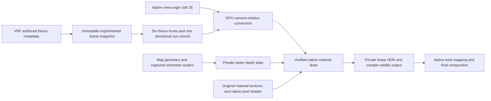

# Owned native lighting experiment

Experiment status and acceptance record. Current behavior and open verification gaps are in
[whole-map relighting](whole-map-relighting.md).

Status: unfinished, visually broken experiment; acceptance failed. The proof is console-only,
opt-in and off by default. Partial floor coverage, unresolved blended draws, MSAA coverage
composition, and native emission and specular parity prevented acceptance. For the current
direction, see the [replacement evidence](lighting-replacement-evidence.md) and the
[whole-map relighting contract](whole-map-relighting.md).

The opt-in experiment lights native Mirage market floor materials from a private authored light
record. A private raster shadow atlas produces counter and shelf shadows and a moving editor box
shadow. With the sun below the horizon, turning off the lamp removes this contribution. Walls and
other unsupported draws keep their native lighting, so the whole-view dark-baseline criterion
fails. Native specular parity and all-material coverage are not established.

## Integration boundary

The engine still renders its ordinary draw. The experiment submits the native material again into
private HDR targets with owned lighting bindings, then uses explicit coverage to choose the result
before tone mapping. This is extra rendering inside a live frame, not playback of a recorded game.
It is not yet an independent whole-map renderer, and it adds draw and composition overhead.

The proof spawns no
server light and needs no populated native light cluster. It supplies its own light records and
mask. Original material textures, shader instructions and draw geometry supply the surface
evaluation. Unsupported draws stay native.

## Binding evidence

Sources: local VRF revision `252ec35cf0ee58fc4454efd5fc6a1baf0c916b40`, its
[barn-light shader](https://github.com/ValveResourceFormat/ValveResourceFormat/blob/252ec35cf0ee58fc4454efd5fc6a1baf0c916b40/Renderer/Shaders/common/lighting.barn.slang),
and shipped CS2 DXBC extracted by [the hash-matching tool](../../Automation/tools/extract-lighting-proof-shaders.py).
Each native table entry is checked against the full shader-program hash. VRF struct layouts are
not copied into engine memory.

| Native program hash | Material family | Private light SRV | Shadow comparison sampler | Evidence/confidence |
| --- | --- | --- | --- | --- |
| `947cc1e2af98cf4b` | Lightmapped | t18 | s6 | DXBC plus live market-floor light/color/shadow response; high for these bindings |
| `cd2f50b4703ab117`, `11b1eacf862919ce` | Lightmapped | t20, t24 respectively | s6 | DXBC verified; individual visual acceptance incomplete |
| `a8163867e71fb140` | Complex | t17 | s7 | DXBC includes dynamic material/specular evaluation; live specular acceptance incomplete |
| `ce791603a66e078c`, `fb9f2812009bb034` | Vertex-lit | t16 | s7 | DXBC verified; individual visual acceptance incomplete |
| `5eef8b3b25bf9f0d`, `942119fdd8d14bf9`, `a9e29effb0c2a1ea` | Vertex-lit/lightmapped permutations | t14 | s6 | DXBC verified; alpha-to-coverage still rejected |
| `7d946d9f3d3aac11`, `a6f8e07e40c2f552`, `e11f2e014ea4d4b8`, `3be7673b879d8c5c` | Vertex-lit/lightmapped permutations | t14 | s7 | DXBC verified; individual visual acceptance incomplete |
| `d2f02d2a090cd686` | Static overlay | Not supported | Not supported | Different cb3 layout (36 entries); current adapter is incompatible |

For the allowed permutations, DXBC establishes these inputs:

| Input | Meaning and owned replacement | Runtime verification |
| --- | --- | --- |
| Structured records, stride 480 | Matrix bytes 0-63; position/reference-distance at 128; attenuation 144; radiance 160; quaternion 176; angle 192; shadow atlas transform 208; cookie edge 224; baked mask 240; minimum roughness 256; shadow strength 260; flags 264 | Fixture color/intensity and shadow toggles alter native floor output |
| cb4[35].xyz | Native camera-relative origin; GPU rebases fixture position and matrix translation using the same buffer as the material draw | WARP readback and live red-light comparison; directional sun vector remains untranslated |
| t13, cb3[19], cb3[22-23] | Owned seven-bit culling mask and one cluster, six fixture faces plus sun | Works without a native fixture cluster |
| t6, verified s6/s7 | Private 4096×2048 atlas, six 1024² fixture faces and one 1024² sun tile; conventional depth comparison | Six depth-center readbacks, moving-light regression, live moving-box and counter shadows |
| cb3[0-3], cb3[1953].z | Point-sampled PCF offsets and comparison bias | Private sampler/zero offsets and -0.0002 bias tested on the market floor; broad bias/filtering acceptance pending |
| t1-3 for verified baked permutations | Zero Texture2DArray resources for baked direct/irradiance inputs | Supported floor darkens with all owned sources disabled; whole-view dark baseline fails |
| t7, t12, cb3[20-21], ambient constants | Neutral screen irradiance/fog cube, disabled probe loops and configurable fallback indirect term | No independent reflection/indirect quality acceptance yet |

Resource and sampler overrides are restored after each additional material draw. Private shadow work
uses a deferred command list executed with immediate-context state restoration. The atlas is
completed before its light records are bound. This is synchronous readiness, not the planned
asynchronous whole-scene generation publication system.

## Implementation notes

- Native material varyings are camera-relative, so GPU rebasing uses the actual native view constant buffer.
- Native cookie fade with equal endpoints gives an invalid denominator, so the full-sphere test uses a finite thin edge fade.
- Depth is copied into the shadow atlas through a same-size non-depth transfer texture before packing. All six live depth centers contain plausible values.
- The experimental HDR path has its own composition gate, so it runs when surface lighting is disabled.

The current intensity conversion is a provisional full-sphere lumen conversion. The selected
authored light also has angle, unit/version and legacy-brightness metadata. Authored brightness
parity, cookie shapes and all fixture families remain unverified.

## Reproduction and observed acceptance

Use the installed development DLL in offline Mirage. Run `exec dev` once after joining, wait for the
match restart, then run [verify-owned-lighting.ps1](../../Automation/verify/verify-owned-lighting.ps1).
It requires the exported `mirage-authored-lights.json` and the baseline preset named by its
parameters. It fixes `mirv_fov 110`, exposure 1 and the market camera pose, saves the current scene,
captures stock/custom/shadow/dark views, records a moving obstruction, then disables the experiment
and restores the saved scene. Scene format remains 14.

Commands are under `mirv_filmmaker environment proof`: `load <metadata> <identity>`, `on`, `off`,
`status`, `fixture 0|1`, `color r g b`, `intensity value`, `range value`, `indirect value`, and
`shadows 0|1`. The last control affects fixture shadows. Sun direction and intensity use the
existing climate controls; its private shadow is always enabled. The stable fixture identity is
`maps/de_mirage/entities/default_ents.vents_c:hammer:2:60417:6655`.

Generated evidence in `Automation/output/lighting-replacement`:

- `de_mirage-fixed-atlas-on.png` / `de_mirage-fixed-atlas-off.png`: matching lamp at intensity 4;
  counter/shelf shadows change while the sun is at -5 degrees.
- `de_mirage-blocker-left.png`, `de_mirage-blocker-right.png`,
  `de_mirage-blocker-unshadowed.png`: moving box changes native floor occlusion; turning fixture
  shadows off removes it. The editor box itself uses the existing editor material and is only the
  occluder. Its appearance is not evidence of native material fidelity.
- `owned-lighting.json`: capture paths, raw recording directory, command timings, FOV, exposure and
  restoration preset. Its dark view explicitly includes unsupported native fallback.
- `owned-light-motion.mp4`: encoded 345-frame moving-obstruction and shadow-toggle recording.
- `private-shadow-tests.log`: complete D3D11 renderer suite, including the regression that moves an
  owned light across a wall and reads the actual private atlas.

Native-material tests pass at 1×/4× MSAA, including the seven-record compute rebase and
directional-vector preservation. Existing coverage/state tests exercise synthetic native-style
shaders. They do not prove complete state restoration for every shipped experimental variant.
The live captures use 4× MSAA. An observed market view covers approximately 302,362 of 1,920,000
pixels with the experimental native-material pass. That count is coverage, not quality.

Still failed or unverified: complete dark baseline, static overlays, blended/A2C draws, weapon
parity, isolated diffuse/specular diagnostics, sun-shadow quality outside this room, all-map
coverage, full transition/reload acceptance, and complete performance accounting. Some luminous
fixture surfaces darken in the experiment. Authored emission preservation also remains failed or
unverified, and it must not be confused with the lamp's working illumination. The current shadow is
deliberately hard, and indirect illumination is zero on the tested floor. Black occlusion is expected
in this direct-only diagnostic and is not final-quality GI.

## Expansion specification and gates

1. Material boundary: trace unsupported hashes and blend/depth states. Static overlay hash
   `d2f02d2a090cd686` cannot use this binding adapter. Check compatible shipped dynamic variants and
   their complete dependencies. Otherwise, narrowly instrument the verified material variant. A
   separate material renderer must reproduce layer blending, normal and roughness channels,
   metallic/specular, opacity/sample coverage and emissive evaluation. Do not enable the approximate
   surface shader as a hidden fallback or call it native parity.
2. Lighting inputs: decode authored brightness mode, cones, shape, cookies and shadow flags by
   resource version. Build complete owned per-map light/culling data, stable IDs and separate shadow
   budgets. Validate native dynamic-prop/character casters and local/sun independence before adding
   all fixtures. Bound auxiliary passes separately from user lights.
3. Coherent publication: publish immutable scene generations only when light records, culling,
   shadow atlas, material bindings and indirect/reflection resources all match. Preserve the previous
   complete generation while asynchronous work is pending, and reject stale jobs. Exposure only
   changes finishing constants. Geometry/material changes invalidate dependent geometry. Moving
   actors update their dynamic layer.
4. Persistence: introduce scene v15 with empty fixture overrides and default quality for v14. Keep
   autosave and cache versions independent. Store per-map resource-scoped fixture IDs, sun and
   fixture overrides. Debounce accepted edits and flush on exit. Preset loading takes precedence for
   the session. Saving resets deliberately, and a previous valid autosave is retained.
5. Caches: separate content-addressed geometry/material metadata from lighting results. Keys include
   referenced resource content, converter/shader versions, GI settings and relevant edits. Persist
   portable data with bounded lengths, checksums and version manifests, and replace it atomically.
   Recreate GPU resources and preserve the working scene on failure.
6. Indirect/reflections: first validate neutral inputs across supported materials. Then supply
   material-aware albedo/emission and fixture lighting to interactive GI, and refresh specular
   environment inputs. Remove baked contributions only when replacements are ready. Ray-traced and
   final accumulation remains separate subsequent work, with explicit capability and convergence
   gates.
7. UI and rollout: surface capability, preparation/cache status and rebuild reason. Expose per-map
   fixture enable, color, intensity, range and shadow edits after the proof passes. Review shared UI
   in the browser mockup, then in CS2. Gate Dust2, Nuke and Train on Mirage material, stability,
   shadow and reflection acceptance, with cold, warm, edit, GPU and replay costs reported separately.
