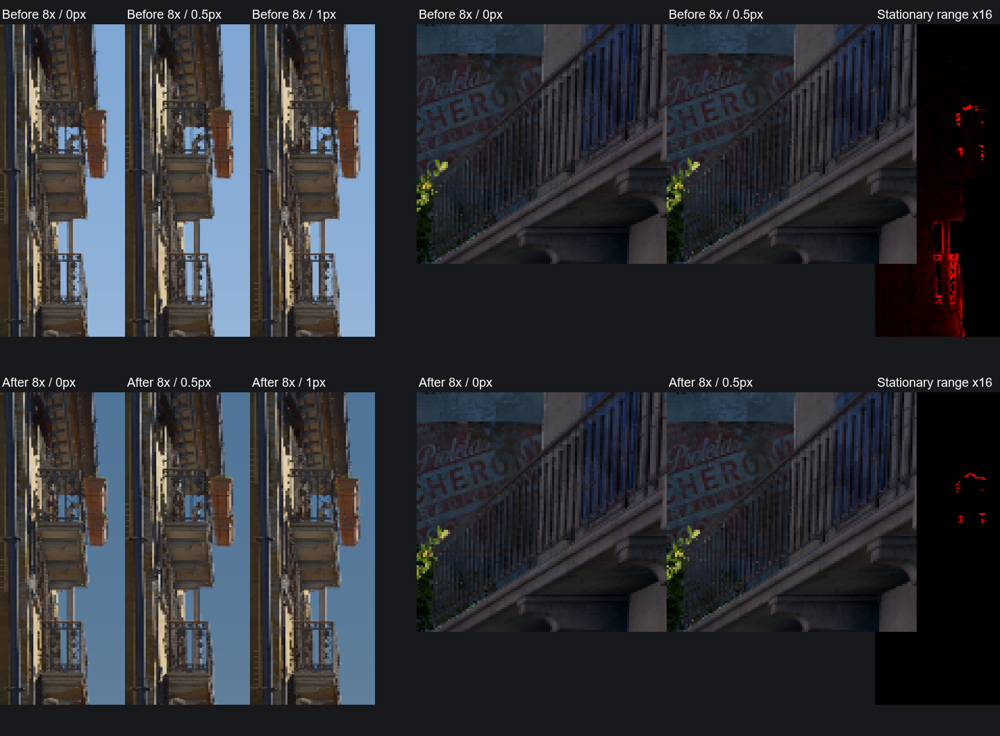

# Whole-map relighting from authored map lights

## Current verification boundary

Standing-shot captures show warm gun illumination with no thin metallic outline.
The final real round emits light; held empty attack and three fresh dry clicks produced no new
muzzle events. A live two-inferno check assigned two moving shadow patches to each fire.
World weapon and first-person capture diagnostics are active, and opaque `csgo_simple`
draws are accepted. These checks cover the tested Inferno scene, not every map or asset.

Casing shadows have **not** been visually verified. Offline Inferno checks
captured actual standing and crouching shots with On and Modern packs. Muzzle diagnostics
follow the lowered viewmodel attachment and assign moving shadow tile 0 immediately.
Dark-church bursts are in `Automation/output/muzzle-lighting/`; separate live
shots have different random particle shapes and capture spacing, so these are visual
comparisons rather than exact pixel regressions.
Transparent/additive muzzle particles remain excluded from opaque shadow capture.

Sun visibility's blocker-search reach is 8192 world units. Slope-aware
MSAA continuity keeps soft filtering on continuous receivers while retaining native per-sample
coverage at silhouettes; this does not claim that all temporal edge flicker is eliminated.

Stained-glass beams use a pane-aligned oblique near plane and a general affine inverse for
cluster bounds. Owned local-shadow guards enforce valid atlas occlusion even when a native
view flag would bypass it. Exterior church wall and hand captures show no meaningful leaked
colour; light passing through the open doorway remains valid. Actors are not yet
included in the glass-beam depth pass. The `dumpsun` `.glass` companion stores, per beam,
16 float32 matrix values followed by a 128 × 128 float32 depth tile, without a file header.

## Smoke and VFX lighting

With Environment relighting enabled, native volumetric smoke samples the current sun,
shadow atlas, local lights and live probe irradiance. The replacement runs inside both
native smoke ray-march branches, retaining the density, transparency, volume detail and
compositing outputs. Native voxel illumination is divided out of the retained scalar
self-shading and is not added to the replacement. Directional probe bands blend
for multiple scattering, and direct shadows use filtered comparisons. Unexpected shader
layouts retain the native program rather than applying an unverified patch.

Gunfire, HE/flash detonations and planted-bomb explosions create bounded, short-lived
Environment lights from game events before VFX-pack selection. Suppressed firearms emit
less light. The muzzle follows the rendered first-person attachment for the viewed pawn,
including crouching; other players use their world weapon. Stale attachments near the
player's feet are rejected. The separate first-person projection receives a reduced muzzle
response, and broad VFX sources limit sharp analytic specular peaks without changing the
weapon's material textures. The local muzzle and held wick do not sample the mismatched
third-person proxy shadow on first-person hands; world geometry and other players' flashes
keep their shadowed illumination. The local muzzle uses an 18% first-person energy scale
with broad highlights. Gun light is driven by `weapon_fire`, not trigger input or the
empty-weapon event, so the final real round lights correctly and subsequent dry clicks do not.
Muzzle energy fades continuously from its peak over 0.06 seconds of demo/game time. Explosion and fire
envelopes retain their separate timing. Slow playback stretches the flash in wall-clock
time; pausing retains the same energy.

Converted muzzle smoke remains an authored sprite effect. Smoke and dust renderers use a
restrained 0.20 visibility floor and native per-vertex lighting after the layering.
Dark-church AK-47 and suppressed M4A1-S captures show visible smoke after the flash, and
`fx recent` records the pack redirects. Additive flames/glows, alpha coverage, motion and
lifetimes remain intact. This uses the native sprite lighting path, which does **not**
sample the custom Environment shadow atlas/probes; the volumetric-smoke replacement
described above applies to native grenade smoke, not muzzle sprites.

Native spritecard smoke casts alpha coverage into the Environment shadow atlas.
The capture retains the native world-space vertex pose (`TEXCOORD2`), sheet frames,
channel mapping and vertex fade; it does not invert the near-camera-adjusted clip depth
or replace the visible effect with a solid proxy mesh. Both the world `.95` and first-person
`.1` depth ranges are supported. Coverage uses stable texel dithering and existing shadow
filtering. Additive flash/glow is rejected; scene-lit converted smoke retains its physical
sheet density even when its native output alpha is additive. Empty published frames clear
finished effects. Unsupported layered/distortion texture modes, predicated/indirect draws
and non-triangle sprite paths fail closed.

Offline Inferno AK-47 checks exercised **On and Modern**, with bullet-impact particles
blocked for the isolated muzzle checks and `fx recent` confirming the selected pack.
Paused-pose A/B captures and shooting bursts are in `Automation/output/muzzle-shadow/`.
The console control `mirv_filmmaker environment particle-shadows 0|1` changes
only this coverage and defaults to enabled on a fresh process. The visible sprites and
weapon-fire light envelope remain native/unchanged. This is coverage-based attenuation,
not volumetric multiple scattering; fine wisps can remain subtle at preview resolution.
`EnvironmentParticleShadowTests` verifies world pose despite adjusted clip depth, sheet
alpha/RGB channels, frame interpolation, fade, first-person capture, expiry, and emissive
rejection. Custom shadow **receiving** on muzzle sprites remains unimplemented.

Molotov illumination follows the native simulation: the lit held wick uses the model's
`molotov_particle` attachment while the pin is pulled, and the burning projectile moves its
light with the bottle. Ground fire reads `C_Inferno`'s individual burning positions every
frame. Up to four representative emitting patches cover the spread, including separated
corners; each anchor stays on an actual burning point. The creation event identifies the
client-only inferno by its entity handle and serial, since its script classname is empty.
Their energy follows the number of active flames, with a 0.18-second ignition ramp and
independent, deterministic low-frequency flicker per emitting patch. Missing patches and
inferno expiration/extinguish events start a 0.18-second smooth fade from the current energy.
Native schema fields resolve at runtime; a missing field disables the affected source rather
than reading a guessed offset. Demo time owns
lifetimes, so pauses freeze emission and seeks discard stale sources. Round/map changes
clear transient emitters.

Effect lights enter the native material light list, including the viewmodel. They receive
moving shadow slots immediately, and
never occupy cached static-light tiles. With shadows enabled, overflow transient sources
are omitted until a moving slot is available instead of shining unshadowed through walls.
Multiple sustained fires share the moving slots: each fire gets a representative before
additional patches from that fire, and short flashes take priority immediately. With two
fires and four slots this gives two shadowed patches per fire; firing temporarily reserves
one of those slots without starving either fire. The four-source limit still applies when
more independent effects overlap than available slots.

Opaque `csgo_simple` meshes join the scene shadow capture after the same coverage and blend
checks as other solid props. Transparent and additive effects remain excluded, preventing
square flash-sprite shadows.
Smoke receives these lights too. This does not turn every transparent particle into an
opaque shadow caster or add emission to non-luminous
effects such as blood. Environment disabled retains the game's original smoke lighting.

## Static GI upload memory

Static-map voxelization borrows the cached rigid or collision arrays for GPU upload. Interleaved
render batches are converted in slices of 16,384 elements, with at most 256 KiB of CPU scratch;
it does not duplicate or grow whole-map position, index and albedo vectors. Uploads use the
immediate context so a deferred command list cannot retain every converted slice at once.
The complete GPU geometry buffers remain until voxelization finishes, then are released.
A failed allocation leaves probe GI unavailable for that map instance and releases partial
inputs; another map instance or device reset can retry. This reduces setup memory, without
establishing a cause or fix for system-wide commit exhaustion. GPU tests compare collision
geometry with equivalent rigid and multiple batched inputs across upload slice boundaries.

Animated indirect-shadow capture keeps at most 32 draw-slot buffers. A slot reuses its
allocation when the shader switches between 12-byte opaque vertices and 20-byte cutout
vertices, and grows only when the required byte capacity increases. The current stride and
logical vertex capacity still change with the shader. This avoids repeatedly replacing large
GPU buffers as native draw order changes; it does not reduce capture coverage or establish
that all playback memory growth is gone. `EnvironmentEarlyCasterTests` alternates both
formats, verifies stream-output buffer identity, and reads back opaque and cutout shadow depth.

## Movement profiling and runtime optimizations

Native lighting constant-buffer clones are reused by byte width, and one persistent irradiance
buffer is updated when its packing changes. Engine buffer contents are still
copied for each draw; buffer identity is not treated as proof that the contents are unchanged.
Device teardown releases the clone pool. AO, screen GI and sun visibility use optimized SM5
compilation. Probe hemispheres and the fixed PCSS disk retain their sample counts and spatial
patterns, with repeated trigonometry moved out of the per-ray/per-pixel work.

Half-resolution GI upsampling predicts neighbour depth on the receiver's projected plane.
This prevents a sloped floor from rejecting its own GI samples merely because its view depth
changes across a two-pixel footprint. Foreground/background depth rejection remains active.
The material still evaluates all six ambient-cube bands with its native normal map. This does
not add temporal accumulation or reduce the GI refresh rate.

`mirv_filmmaker health resetTiming` clears a 4,096-sample ring of Present intervals.
Subsequent health output reports mean, p50, p95, p99, maximum frame time and the number above
33.33 ms. These are whole-frame CPU wall-clock intervals, not isolated GPU pass times.
The low-frequency health command copies the ring under a lock and sorts outside it.

[`profile-relight-motion.py`](../../Automation/verify/profile-relight-motion.py) drives a
forward/reverse camera interpolation and records heartbeat-derived FPS and frame-time tails
without recording screenshots during measurement. Run in an already joined offline map:

```text
python Automation/verify/profile-relight-motion.py --routes routes.json --output result.json --seconds 10
```

The routes JSON is an array of objects with `name`, `start` and `finish`; each pose is
`[x, y, z, pitch, yaw, roll]`. Camera sensitivities, offset mode, pose and debug-log state are
preserved. The script leaves the free-camera input active; use `mirv_input end` to resume player
control. It rejects the zero player pose and scenes without meaningful draw activity so a
team-selection/menu frame rate cannot be presented as a lighting benchmark. Camera cuts and
initial region allocation settle before timing. Run captures separately; BMP writes, debug GPU
readback, simultaneous shader tests and builds invalidate a comparable performance run.

**The 30 FPS minimum is not achieved.** Shadow dimensions, filter sample counts and GI ray
counts are kept. Measurements are under the ignored `Automation/output/lighting-performance/`
directory.

Cluster assignment clips light hulls against positive camera W before projecting their
tile bounds. A light crossing the camera plane does not automatically occupy every screen
tile; conservative edge intersections retain its visible coverage. CPU and GPU regressions
cover crossing and fully behind-camera hulls. AO uses fixed octagonal horizon directions
A translated straight-edge GPU
regression covers the fixed directions.

The default remains one bounce propagation step per frame. The 30 FPS minimum remains unmet.
Extra propagation steps do not establish that shimmer is removed. Top-down captures retain
map-cast shadows.

Daylight weapon checks use the saved street finish pose, sun azimuth 0/elevation 60,
viewmodel enabled, and actual forward/backward player movement (`mirv_input end`). It records
99 lossless 1600 x 1200 BMP frames and a 24-frame full-resolution PNG review under
`Automation/output/lighting-performance/weapon/sunlight-final/`. Direct sunlight reaches the
pistol and hands; separate top-down captures show map shadows. The thin moving weapon rim
remains unresolved. Reflection-off and shadow-off diagnostics did not remove it by themselves;
Remaining GI variation and distant lighting acceptance are open.

Verification: 60/61 full native tests pass, with the existing `EnvironmentReceiverTests`
failure. The perspective-floor and background-depth GPU regressions pass, as do the
PCSS sampling math tests. Full JavaScript verification is 438/456; 18 failures remain outside
this change. The environment mock supplies its scene-key dependency (8/8 pass).

## Current implementation

Status: **in development; the fully dynamic replacement is not complete.**

Authored fixture decoding reads the nested VRF properties for cone angles, source sizes,
edge softness and near/far skirts. Rect/barn sources use their authored half extents and
reciprocal near-plane distance to form an expanding projection, with one shadow face and
light record rather than six cube partitions. Tube sources use the native local +Y segment
axis and authored half-length. Spot lights use their authored cone; omni entities retain
full-sphere emission even when their exported property bag contains cone controls.
Native material lighting and GI injection share the resulting emission and analytic edge fade.
Brightness conversion remains provisional.

Owned local shadows use a five-depth blocker search and 32 fixed comparison taps to estimate
source-size penumbrae. Cube faces overlap by 1/0.9 and blend normalized smooth weights;
this avoids a hard rectangular boundary where a soft shadow crosses a face. The
compensated atlas scale preserves the stored shadow projection, and the filter is capped
to the guard remaining after the overlap. Nearby 1024-square faces reserve 96
texels per edge; cached 128-square faces reserve 12. Overlap leaves approximately 50 and
6.2 texels, respectively, available for filtering at the outer edge. A central depth projection still
approximates tube visibility. Nearby shadow residents retain their slots until a challenger
is substantially closer. Preview refreshes every visible light face within its influence range
plus 128 camera units each frame, preserving moving shadows through adjacent doorways. The
budget expands above 32 faces when needed to retain these faces and at least 16 oldest background
faces; distant faces otherwise share the remaining budget. Exports refresh all resident faces.
Overlapping cube faces also use normalized energy weights during GI injection, avoiding duplicate
bounce contributions at edges and corners. See [Wicked engine lighting comparison](wicked-engine-lighting-comparison.md)
for live verification and remaining acceptance.

An enabled Environment scene drives native incident lighting through
[`RelightEnvironmentMath.h`](../../AfxHookSource2/Filmmaker/Relight/RelightEnvironmentMath.h).
Sun direction/color, ambient intensity, procedural sky radiance and global light color update
the material inputs immediately. The differential replay and texture-fill lighting are
bypassed in this path. Material albedo, normal maps, roughness, alpha tests and blending remain
native; illumination is evaluated by the forward material shader.

World shaders have their baked direct lightmap replaced with black, baked bent-normal/AO
input neutralized, and their irradiance query rewritten to sample an owned world-space
six-band Texture3D. Probe-lit materials receive owned probe data. Baked reflection captures
and native sun/light/shadow contributions are disabled or replaced. The owned shadow depths
are generated during the current session and invalidated by light/geometry changes; retained
rigid depth is a runtime cache, not a map bake.

Inferno's main walls and floor use NVIDIA multi-draw calls, which bypass the six standard
D3D11 draw entry points. The standard hooks alone do not cover those NVAPI draws, which would
leave the main map on stock lighting. The native hook brackets both NVAPI indirect multi-draw
operations with the same lighting scopes,
preserving GPU batching and preventing nested fallback draws from replacing inputs twice.
The public ABI is resolved from CS2's already loaded driver module; there is no NVAPI SDK
or redistributable dependency. See [NVIDIA's interface definitions](https://github.com/NVIDIA/nvapi/blob/main/nvapi_interface.h)
and [function declarations](https://github.com/NVIDIA/nvapi/blob/main/nvapi.h).

Live Inferno window captures show the main geometry going dark with zero illumination,
responding across roofs, walls, floors and props to red/blue ambient edits, and changing sun
shadows when the sun direction changes. `mirv_relight bindingcheck 1` temporarily replaces
material RGB with white while preserving coverage; `bindingcheck 0` restores normal shading.
The `.95..1` depth interval used by 3D skybox geometry is included in the lighting scopes.
Distant material fog branches are disabled using their actual opacity operations, including
variants whose enable flag sits in different constant-buffer rows. A zero-radiance outdoor
capture has no blue wash. Bright self-illuminated background geometry still needs
separate visual acceptance; the `1..1` sky backdrop is not a material receiver. Replay coverage
percentages do not prove that the original native draw was replaced.

The NVIDIA game device uses
[`D3D11_CREATE_DEVICE_PREVENT_INTERNAL_THREADING_OPTIMIZATIONS`](https://learn.microsoft.com/en-us/windows/win32/api/d3d11/ne-d3d11-d3d11_create_device_flag)
to avoid an access violation in `RelightIrradianceTests.exe` inside NVIDIA's parallel shader compiler.
This preserves application-side device thread safety. Hardware irradiance tests select the
same serialized driver path by default and execute the shaders against HDR/MSAA targets.
Cold compiler-key tests and live offline sessions pass; future driver changes still require
runtime verification.

The hook extracts each map's authored lights/environment and geometry itself, on first load,
with no external tool ([map data extraction](map-data-extraction.md)). No precomputed radiance or
shadow data is part of that cache.

Owned screen-space AO replaces the native visibility input at `t7`. It reconstructs world
positions from current MSAA depth, estimates hemisphere horizons, and filters visibility across
nearby surfaces. The four native visibility channels receive the same owned AO factor; no native
AO texels are sampled. `mirv_relight ao 0|1|2` controls its strength. GPU tests cover open planes,
corners, immediate blocker removal, MSAA and reversed depth. Live Inferno logging confirms the
owned pass at 800×600 from 1600×1200 4× MSAA depth. The five AO shaders ship in the build bundle.
Recognized material programs also have their actual `cb4[1].x` AO branch enabled when it
contains the verified `t7` sample; the fog flag at `cb4[0].z` is separate. A GPU regression
checks visibility multiplication while preserving alpha and discard. Live visual acceptance
in the shaded arcade remains outstanding.

The version 7 geometry exporter includes `csgo_environment`, `csgo_environment_blend` and
parallax render surfaces. `MVMCAST4` separates shared opaque positions/indices from alpha/animated meshes. Shadow maps
use the actual rigid render geometry from this format; physics remains available for surface
placement and other collision queries. The Inferno export contains 8.38 million triangles
across 843 materials, including 6.97 million opaque triangles. It carries no material RGB,
precomputed radiance, lightmaps or baked shadow results. Nearby shadow selection uses actual
fixture distance and does not exclude emitters because of their compiler shadow mode.

The private shadow cache is keyed by its requested map; sunless frames do not cause repeated
resets. The static tier converges to all 1,242 Inferno faces; zero-energy lighting skips
direct shadow work. Dynamic face updates remain excessive and need spatial restriction.

Current-pose stream-output bounds restrict actor/prop face updates. Bounds come from the
actual GPU positions in whole-triangle blocks, including cable and cutout layouts; invalid or
unavailable bounds retain conservative draws. Native skinned opaque depth-prepass draws with
verified blend-index inputs are also captured before their color draw. Standard and NVIDIA
indirect depth draws copy their current arguments into an owned GPU buffer. A compute pass
counts vertices and generates the shadow draw arguments without a CPU argument readback,
then the original draw replays through stream output. Only opaque or independently verified alpha-masked depth
programs enter this path; unknown opacity remains excluded. Active capture consumers retain
their next-frame request across inactive shadow tiers. Dedicated WARP tests cover indexed and
indirect replay, GPU-culling zero instances, same-frame movement/disappearance, actual shadow
depth and transparent-texel coverage, spatial bounds and binding restoration. GPU-counted
batches resolve one current bounds block each during shadow preparation; counts and indirect
draw arguments stay on the GPU. This does not bypass native visibility culling. Capacity and
predication limits remain explicit; broad batched/off-camera actor coverage needs acceptance.
Live Inferno logging confirms accepted opaque and masked indirect depth draws. GPU-counted
batches resolve one posed-bounds block each (about 10 to 20 at the saved testing views) rather
than dropping these draws.
Live verification still finds foliage activating most Inferno fixture faces, so this change alone
does not establish an acceptable frame rate. Active foliage consumers retain their snapshot
request across inactive shadow tiers, so the native animation clock does not freeze.
Foliage culling derives its displacement margin from current native wind and authored
sway/flutter parameters when the noise texture has a verified normalized format. Unknown
formats retain conservative draws. Argument counting runs on the GPU; overall performance still
requires live acceptance.

Foliage shadow geometry uses 128-unit spatial cells. Resident fixture faces cache their
visible animated ranges; conservative displacement bounds are rounded outward to eight-unit
increments. Culling membership is rebuilt when those bounds change, rather than repeated for
every draw. Smaller face counts alone do not establish an FPS improvement.
Native Map/Unmap and UpdateSubresource uploads retain the wind bytes on the CPU, used
only after shader reflection proves the wind binding and normalized noise format. Partial
uploads, GPU-only copies and invalid values discard that proof and retain conservative
geometry. Shadow deformation still uses the current GPU snapshots; the CPU wind path does not
map a staging resource. GPU-upload and invalidation tests cover this path.

The native material sun uses the shader's own four-cascade loop. The 4096² atlas
footprint holds four 2048² quadrants: close, detail and middle crops, plus the whole map. The
crops are 128 units half extent, the geometric mean, and half of `shadowRange` (1500 units by
default). Each crop sits half its extent ahead of the camera along the view direction
(`NativeSunCropMatrix`, `EnvironmentNativeSunCsmMath.h`). Every crop keeps the full-map depth interval, so
off-screen upstream casters still shadow. Crops snap by whole texels, so a moving camera does not
re-rasterise edges at sub-texel offsets. Measured camera rotation cost remains within noise at the
wide rooftop view. `mirv_relight suncascade <0-3>` shades through one cascade only; `-1` restores
normal selection.

The 3D skybox (viewport depth .95..1) is a scaled miniature in its own coordinate space. Map
shadow maps and map light positions do not describe it, so skybox draws do not sample them.
Skybox draws receive their own exported sun shadow map
and ambient cube, with no foreground clustered local records. Draws that never carry that
lighting interface (the city and mountain meshes authored as unlit effects, and the additive
light shafts) keep daytime brightness in their albedo. While dynamic lighting is on, both follow
the sun: the composite scales 3D-skybox pixels by the energy the relit world receives, and the
additive shafts are dimmed at draw time by `UnlitOverlayScale`. Night leaves a dark city and thin
shafts, daylight leaves the authored picture. The composite does not dim bright foreground pixels
by a luminance test: the native path has already lit them, and a second night factor cut a placed
lamp's pool into a hard-edged crust wherever the albedo crossed the threshold (issue 41). The
clear-depth sky is not modified.

The owned AO pass unprojects positions using the inverse of the captured world-to-clip matrix,
as the environment renderer does. With engine SSAO disabled, CS2 leaves the material's AO
addressing row `cb4[16]` at `(1, 1, .5)`, which would make every pixel read one AO texel.
Owned main-view draws therefore receive a copy of `cb4` whose row 16 describes the owned AO
texture. `environment.ao.inputs` and `environment.ao.output` log these values, including the
mean, minimum, and raw centre texel.

Contact AO prepares positions once per output texel, including MSAA depth resolution, then
integrates newly blocked horizon intervals with exponential distance falloff. Its strength
control increases the final visibility exponent. Open planes and absent depth stay neutral;
the bilateral filter preserves world-space edges. It shades indirect light; direct
self-shadowing is supplied by the sun and fixture shadow maps.

The owned ambient is sky light, so sky visibility keeps sealed interiors and narrow alleys from
lighting as brightly as open squares. Runtime sky visibility draws the map's own static render geometry into fourteen
whole-map 1024² depth maps from fixed sky directions, two per frame, once per map. The AO pass
then weights the directions reaching each pixel by its normal and multiplies the result into
the same owned visibility (`EnvironmentSkyVisibilityMath.h`). No Valve data is read. Sky colour
and intensity still come from live settings. `mirv_relight skyocclusion <0-1>` controls it. The
roofed church reads roughly zero sky; open ground reads one. Runtime probe bounce, described
below, supplies indirect light through openings; contact AO alone cannot determine room closure.
Contact AO strength zero preserves separately enabled sky occlusion.
Together, AO and sky visibility measured about 1 ms at the saved foliage view.

Runtime bounce is on by default and updates continuously (`RelightProbeGi.cpp`,
`RelightProbeGiShaders.h`, `RelightProbeMath.h`).

- Real surface colour. Map preparation (converter 9, `MVMCAST6`) stores each render triangle's
  linear material albedo, averaged from the material's base-colour texture times its factor.
  Cutout batches store one albedo per batch. This is material reflectance, not baked lighting.
  The whole map is voxelized once from this render geometry at 20-unit cells, spread over a few
  frames at load; cutouts and animated foliage are porous (35% coverage). Packs from other
  converter versions are rejected and rebuilt.
- Stable map occupancy. Posed characters and world weapons receive probe lighting and
  retain their direct shadows, but do not enter the coarse indirect voxel grid. Animated
  occupancy is not rasterised, so small idle animations do not change 20-unit cells near the
  viewer, move probe origins, block sky visibility or alter the shared reflection capture.
  The tradeoff is that characters do not block or contribute colour to voxel indirect transport
  or reflections.
- Camera following without flip-in. A 2560-unit region moves in single 40-unit probe steps.
  The region centre leads the view by 640 units, retaining coverage behind the viewer while
  extending full-resolution transport farther down the visible street. Invalid or missing
  view directions retain the camera-centred fallback.
  When it moves, history shifts by whole probes and all newly exposed probes are traced in
  that same frame. The first complete field is published immediately after static voxelization
  and initialization. Camera cuts initialize the full region; they can cost more than an ordinary frame.
- Continuous update while solving. Direct light is injected every active solve frame. Each 8-voxel brick tests only
  the light records whose range reaches it, rather than all ~1243. The bounce solution
  is fed back into injection, so multiple bounces converge over successive frames. Background
  work covers a sixteenth of the probes per frame in a world-anchored pattern, plus a
  16-by-16-by-16 neighbourhood around the camera every frame. Anchoring the background phase
  to world cells prevents scrolling from starving individual probes. Current main-pass depth
  marks visible receivers' cage corners and composition neighbours for the next frame.
  A GPU counter deduplicates these cells and builds an indirect trace dispatch; retained
  visible probes refresh before composition and reflection normalization, independent of
  the background phase. Material draws consume one immutable lighting snapshot. The depth
  pass does not rewrite irradiance or ping-pong its visibility while materials sample it.
  Retained visible cells skip duplicate background work; scrolling disables that skip until
  the mask matches the new region. Repeated draws cannot advance either pass twice per frame.
  Position preparation remains available with AO disabled; missing current depth retains
  the background/nearby fallback. Sixteen cosine-weighted
  rays per band use a stable world-cell hash. Refreshed probes replace their old values
  immediately; deterministic quadrature does not need temporal smoothing. Authored RGB
  edits double background work for 24 frames
  (three sweeps). Depth-driven priority has one frame of latency; nearby direct changes
  still refresh each frame, and camera cuts initialize newly exposed cells immediately;
  offscreen and recursive bounce still converge over several frames. Composition averages
  open neighbours (weight 2:1), testing blockers between their actual relocated origins.
  Thin walls and corner visibility remain limited by voxel and distance-band resolution.
- Settled transport. After 48 unchanged solve frames (three background sweeps), reuse the
  map irradiance, visibility and reflection snapshot. Repeated injection of animated shadow
  depth would keep an otherwise stationary map's recursive solution and reflection normalization
  oscillating, so it is excluded from the settled snapshot. Camera movement, region changes,
  authored lighting, shadow-record reassignment, bounce strength, reflection strength, iteration
  count and diagnostics resume updates immediately. Direct shadows and native actor/foliage
  animation remain live. Indirect light and reflections do not track animated casters while
  the static-map solution is held;
  this is an intentional stability/performance tradeoff. The cache does not solve spatial
  voxel aliasing during movement, and the initial 48 frames still converge.
- Surface-adjacent dark marks. Diffuse rays traverse exact voxel boundaries and load
  occupancy without trilinear filtering. Opaque voxels do not expand into
  empty space beside walls and ledges. Opaque voxels store separate outgoing radiance for each
  side of the surface. A backface hit blocks sky and contributes its own side's bounce to
  the hemisphere average. Excluding it from that average would let exterior skylight
  brighten sealed indoor ceilings. Receiver queries use a 0.35-probe outward offset
  (14 world units at the current spacing) in both native shaders and the screen cache.
  This reduces visibility self-occlusion at the 20-unit voxel boundary; it does not seal
  holes in geometry or provide triangle-level visibility.
- Leaks. A probe inside geometry selects one adjacent open origin within half a spacing,
  shared by all colour and distance bands. The signed relocation is stored with the moments.
  A changed origin discards the stored history. Probes without a safe origin stay invalid.
  Receiver visibility blends the signed directional estimates continuously and applies a
  wrapped surface-facing weight. The volume carries sky visibility, so AO drops its
  screen-space sky term while bound.

Controls: Lighting's Bounce intensity slider sets displayed reflected-light strength from 0 to 4.
Zero removes displayed bounce while preserving probe sky visibility. Recursive transport uses
a fixed 0.95 feedback gain, independent of this display control. `mirv_relight gi 0` separately
disables the GI implementation for diagnosis. Diffuse and reflection rays read the appropriate surface side at radiance level zero.
Radiance/direction volume mips are not generated; the reflection cubemap retains its mips.
Lighting's **Bounce steps/frame** control accepts 1, 2 or 3 (default 1), also available through
`mirv_filmmaker environment climate bounceSteps 3`. Each step injects the preceding probe
solution and updates another background slice phase, while reusing the frame's voxelization.
Composition and reflection mip generation happen once per frame. This controls propagation
iterations per frame, not a maximum physical ray-bounce depth: feedback continues between
frames. More steps cost GPU time and are an experimental convergence control, not a shimmer fix.
The value is saved with the environment and returns to 1 on Lighting reset.
Recursive feedback uses visibility-weighted neighbouring probes, including their relocated
origins, and rejects fully blocked or uninitialized history. Static-grid dimensions are uploaded
with the map geometry so the tracer can actually read static occupancy and material albedo.
GI records refresh when their contents change, including camera-dependent shadow-atlas tile
assignments; unchanged records retain their GPU buffer.
`mirv_relight giscale 1` is the default and uses native per-pixel world queries. The opt-in
`giscale 0.5` caches six irradiance bands at half screen resolution with depth-aware upsampling.
The cache derives its sampling normal from screen depth, so thin geometry and moving depth
edges can differ from a native receiver query. Missing or incompatible
depth falls back to the world query. Live samples have not established a meaningful
overall FPS gain; see [Wicked engine lighting comparison](wicked-engine-lighting-comparison.md).
Visible refresh covers every cage reachable by the receiver's 0.35-probe normal bias and the
face neighbours used by composition. A diagonal normal bias can otherwise read a cell left on
the slower background schedule. GPU regressions cover those diagonal dependencies, composition
neighbours and compact-list deduplication.
Stationary and street checks in offline Inferno do not establish that rail shimmer is eliminated,
because animated geometry and shadows contribute to the variation. The map-wide 30 FPS minimum and
complete lighting acceptance remain unmet.
Global world light colour reaches the sun, lamps and sky in both Environment-owned and
standalone Relight modes. Global hue edits invalidate the probe field even in lamp-only scenes.
The composite's own world bounce is forced off.

Preview refreshes at most 128 cached fixture faces per frame, with age/visibility/proximity
priority and an oldest-face reserve. Cached static shadows remain resident throughout the map;
moving-caster shadows can lag in the cached tier. Sun cascades and the high-resolution local
tier keep their normal updates. Movie exports refresh every resident cached face.
`mvm_debug` reports asynchronous GPU stage times under `relight.probe.gi.gpu` and cached-face
counts under `environment.relight.shadow.spatial`. Preview bounds readback is nonblocking;
unavailable current bounds conservatively include casters, while exports wait for exact bounds.
The controlled church view remains below the 30 FPS minimum. The
[Wicked engine lighting comparison](wicked-engine-lighting-comparison.md) records diagnostic timings
and remaining representation limits.

Street-route captures (32 full-resolution PNGs in each direction, plus a top-down check and a
red-sun edit) show map shadows, and large wall spots and square patches are reduced in these views.
A GPU regression verifies nearby transport responds to an unchanged-count shadow-atlas
reassignment within four updates. This is route-specific evidence, not whole-map visual acceptance.
The full native suite has the existing `EnvironmentReceiverTests` failure; see the comparison for
remaining representation limits.

Known limits: animated characters are excluded from indirect voxel transport and reflections.
Off-screen direct-shadow casters are still subject to the engine's own visibility culling. Surfaces beyond
the region clamp to its border probes. The [Wicked Engine comparison](wicked-engine-lighting-comparison.md)
details remaining visibility, relocation, transmission, AO and scheduling work. The church
controls and fixed top-down shadow coverage were inspected in game; glass transmission,
coloured bounce and exhaustive fly-through acceptance remain unfinished.

Live reflections. Reflections do not use the map's baked reflection cubes. Each frame a 128² cube is marched
from a retained capture point through the lit map bounce voxels (sun, fixtures, bounce); rays that leave
the region see the sky. It fills the native clustered reflection list (`cb3[20]`) as one
map-wide record at `cb3[25..33]`: a box far larger than the map, so parallax correction reduces
to the reflected direction; strength in the tint row; and a normalization row written on the
GPU from the capture point's probe irradiance. The material divides local ambient by that row,
capped at one (`cb3[6]`), so a reflection is dimmed on surfaces darker than the capture point
and never brightened past it. `cb3[24].y` is the cube's mip count. Record layout and the
fixture-mirrored lookup are in `ReflectionRecordRows` (`RelightProbeMath.h`). The capture point
stays fixed until the camera travels 40 units. Moving captures retain 80 percent history for
both cube radiance and its normalization row, preventing small steps from changing their
relative brightness. First captures, authored/display edits and large cuts bypass history.
This remains one coarse voxel capture, with approximate silhouettes and no local parallax.
The Lighting
page's Reflections switch and `mirv_relight reflections <0-2>` control it.

Rect and barn lights are always kept. Maps light real fixtures with `light_rect` and
`light_barn` emitters as well as omni and spot lights (Office's ceiling panels and wall sconces,
Inferno's 61 rect and 25 barn emitters), so emitter shape cannot identify a "fill" light. Switch
individual lights off in the light editor.

Cast shadows, ambient occlusion and sky occlusion default to on and stay on after a Lighting
reset, so turning dynamic lighting on always gives shadowed, occluded interiors.

Rect and barn projections feather at least the outer 15 percent of their extent; larger
authored softness is retained. Their shadow filter uses the decoded physical source radius
instead of the full emitter dimension. This softens hard fill boundaries while retaining window
occluders and avoiding excessively widened, layered projection edges.

Light editor. Lighting → Edit lights (`mirv_relight lighteditor on|off`) closes the panel and
draws a marker on every map light: bright when it shines, red when switched off here; markers fade with distance (full within 400 units, faint by 2000)
so a room's own lamps stand out. Aiming at a light within 600 units rings it; F switches it off or
back on (one switch per press; the game delivers a second key-down ~250 ms later), Esc leaves.
Choices are saved per map in `%APPDATA%\HLAE\source_mvm\relight\lights\<map>.txt`, keyed by the
light's authored identity (else class and rounded position).
Turn all back on (`mirv_relight lights reset`) clears them. Math: `RelightLightEditorMath.h`;
markers and keys: `RelightLightEditor.cpp` (drawn at the end of the Environment composite; keys
from `MovieMode::OnKey` before any director binding).

Stained glass. It is opaque geometry and stays a sun shadow caster, so plain
sunlight never passes it. Map preparation stores its triangles, UVs and colour image (the one
family selected by material name: no material flag marks transmission). Converter v15 uses the
self-illumination artwork when a stained-glass material supplies it, otherwise its base colour.
This image is a bounded transmission colour; authored emission brightness is not exported into
beam energy. Map packs from other converter versions must be rebuilt to obtain it. At runtime the panes
are grouped into windows. Each window the sun reaches gets one directional record whose
projection starts at the glass and runs 2048 units away from the sun, with a projected cookie:
the glass drawn in that projection in its own colours, masked where the sun does not reach the
outside of the glass. The native material's cookie path (`radiance.w > 0`, the program's one
non-probe texture3d) lights the room in the window's colours; the bounce injection samples the
same cookie. Verified orthographic beam volumes are bounded in the screen/depth light clusters;
the unbounded sun stays map-wide. Each beam has a dedicated depth tile starting just behind the glass: opaque
exported walls, floors and static props stop the colour, while the pane does not shadow its
own beam. Posed actors are not included in this beam pass yet. Missing incident-sun visibility
data fails dark; zero sun radiance creates no beams. The exported stained-glass material's baked
self illumination is suppressed while dynamic lighting owns the map, then restored when it
releases ownership. The glass surface receives the live material lighting instead of glowing
in darkness. Math: `RelightStainedGlassMath.h`; GPU: `RelightStainedGlass.cpp`.
It is always on; `mirv_relight stainedglass <0-2>` is a diagnostic.
The GPU regression in `Automation/tests/relight-probe-gpu-tests.cpp` renders the production cookie
shader with lit and blocked panes, then checks relighting, sun-off, below-horizon and missing
visibility transitions. Sky illumination alone does not produce a directional coloured beam.

Sun cascade dump. `mirv_relight dumpsun <file>` queues a render-thread readback to the
specified output file. It writes four blocks in whole-map, middle, detail, close order. Each
block contains 16 little-endian float32 matrix values followed by a tightly packed
`SunCascadeSize × SunCascadeSize` float32 depth tile (currently 2048 square). Matrices are
row-major world-to-shadow transforms, without a container header. The command needs the owned
sun atlas and waits until cascade matrices are available; the debug log records the write.
When an exported 3D skybox has an active sun shadow map, a companion `<file>.skybox`
contains one matrix and one depth tile in the same block format, using skybox coordinates.
The dump is a diagnostic output and can stall rendering during readback.

Windows. Converter version 16 keeps opaque painted windows according to the authored
material flags, including `italy_windows_glass_01a` (`csgo_simple_3layer_parallax`). A material
name containing `window` or `glass` does not make the rendered surface transmissive. Placed
opaque triangles of these materials stay in the persistent caster mesh, so sun cascades keep the
same blockers as native indirect depth draws, independent of the receiver camera. Genuine
translucent, additive, overlay and `F_DO_NOT_CAST_SHADOWS` materials keep their exclusions; stained
glass keeps its explicit colour-transmission path. Map packs from other converter versions must be
rebuilt to obtain this geometry.

The hallway regression uses matching camera poses, a frozen-time camera test, and a walk through
the boundary in both directions. The authored local lamps remain on. Evidence is in
`Automation/output/hallway/compare.html`, with native captures and shadow-depth analysis. Persistent
geometry is added rather than altering cascade selection or sun bias.

Light-blocking brushes. Maps seal roofs and walls whose render meshes leave gaps or open backs
with invisible `toolsblocklight`/`toolssolidblocklight` brushes (`generic.vfx`), which the
engine's lighting respects. Their triangles cast shadows (never drawn), with a dark neutral albedo
in the bounce voxels (their texture is a debug colour). Inferno: 3,829 triangles. Converter version 13.

Probe transport quality. The D3D11 voxel/probe path uses the local Wicked Engine
DDGI implementation (WickedEngine's `ddgi_updateCS.hlsl`) as a
reference for relocation and hit-distance visibility. Sixteen world-stable cosine-weighted voxel rays
update each of six directional bands, accumulating radiance and first/second distance moments.
Material queries interpolate the eight surrounding probes, reducing each weight using a cubed
Chebyshev visibility estimate. Completely occluded cages contribute zero instead of renormalizing
tiny blocked weights into full brightness. Below the normalization confidence floor, irradiance
fades continuously with squared confidence rather than switching abruptly to black; this is
shared by native queries, the screen cache, and recursive transport. Distances are stored in probe-spacing units to avoid
half-float overflow. This applies to both recognized lightmapped and native probe receivers.

A probe against geometry shares one nearby open origin across all six bands, within half its
spacing. Probes with no safe origin remain invalid. Smoothing and invalid-band filling test
the full segment between relocated neighbours at half-voxel steps. Newly
exposed scrolling probes and their distance history start unknown. GPU tests cover visible
probe albedo, fully blocked cages, distance output and scrolling irradiance.

The local `ddgi_rayallocationCS.hlsl` also informs visible-work prioritization. Wicked adapts
ray budgets using frustum and variance information; this implementation uses current depth
to refresh receiver cages, with fixed ray counts and no CPU readback. Separate GPU queries
report the background and visible stages as `relight.probe.gi.gpu` and
`relight.probe.gi.visible.gpu`. Reduced dispatch work alone is not evidence of an FPS gain.

This uses six directional moment bands rather than Wicked's octahedral maps; voxel rays do not
provide hardware triangle intersections or Lumen's surface cache. Thin geometry below voxel
resolution, coarse visibility within one band, and material permutations without recognized
position/normal inputs remain limits. It is a DDGI-inspired transport improvement, not Lumen parity.

Local-light shadow filtering. Verified native local-light kernels use a deterministic 16-tap disk
filter over the original depth, sized by each light's atlas face and the user source angle. Both
nearby and cached map lights use it.
The 12-texel guard band isolates adjacent faces. Unrecognized kernels retain the native fallback.
Live church close-up captures show softened edges; top-down captures retain the foreground
building and tree silhouettes.

Outside-map trees. Converter version 14 follows the map's authored `skybox_reference`
package and exports its actual placed world nodes, including cutout foliage, into a separate
checksummed caster payload. Inferno adds 289,662 skybox triangles and three cutout batches.
The 3D skybox receives a separate 2048-square sun depth map in its native miniature coordinates.
The authored `sky_camera` scale and origin place a 512-unit half-extent crop around the viewer.
Receiver heights tighten its depth interval; distant mountain billboards therefore do not
reduce nearby village trees to subpixel casters. Packs without camera metadata use
the whole-sky projection. Distant scenery beyond the crop remains unshadowed.
Its bounds never enlarge foreground cascades or enter local-light, weather or bounce geometry.
Both package and payload hashes are checked when loading. Multiple skybox world groups currently
require explicit active-group selection rather than guessed placement.

Inferno regression verification. The church close-up shows no comb-shaped local-light stripes. Real Config screenshots confirm Sun size, Light source angle
and Shadow softness in one group. A fixed top-down shadows-on/off comparison preserves
foreground building shadows and changes 11.2% of the sampled outside-tree field by more than
10 RGB levels. Sampled church/courtyard props retain material shading. Stained glass stays
unlit at night, beams fail dark with no incident sun, and disabling Environment restores the
original glass material parameters. These checks cover Inferno, not every prop on every map.
The full native suite passes 60/61 with the existing `EnvironmentReceiverTests` failure;
the full UI suite passes 429/453 with the same 24 existing failures. Focused lighting UI,
map packaging and documentation checks pass 24/24. The DDGI-inspired voxel tracer is not
Lumen or Wicked Engine feature parity; thin geometry and unsupported material permutations
retain the limitations described above.

Sun size. The sun is a disc (0.53 degrees for the real one), so a shadow is sharp where the
caster touches the receiver and widens with the distance between them: penumbra
`w = d · 2 · tan(A/2)`. Programs whose cascade loop ends in the engine's screen-space shadow hook
(`if_nz cb4[1].y; sample_l; min`) have that block taken over (`EnvironmentNativeAtmosphereMath.h`):
the flag reads `cb3[1953].y` and the `min` becomes a copy, so the bound texture is the sun
visibility. `EnvironmentSunVisibility.cpp` computes it once per frame after the depth prepass: a
blocker search over the cone the disc subtends (giving the mean blocker distance), then a
receiver-plane-biased filter of that radius over the same cascade the native loop would pick, with
its 12% cascade blend. The blocker search extends to 8192 world units. MSAA depth validation
accepts the within-pixel depth span of a sloped receiver using its adjacent depth gradients;
distant ground does not fall back to the sharp native filter solely because its samples
span more than a fixed tolerance. Foreground/background and sky mixtures retain the
per-material fallback. GPU tests cover both conventional and reversed depth. Draws with blending, other viewports (the first-person pass) or no texture
keep the native filter. Setting: Lighting → **Sun size** (climate `sunAngle`, 0 to 5°),
`mirv_relight sunsize <degrees>`. Math: `EnvironmentSunVisibilityMath.h`. A forced cascade
(`mirv_relight suncascade 0-3`) runs the engine's own loop instead, for A/B comparison.

Sun contact projects the actual receiver with no normal displacement. Each bilinear depth texel gets its own receiver-plane reference,
so a slope correction cannot move a receiver through a neighbouring wall. Sun raster
slope bias is zero; receiver roundoff is capped at 0.05 world-space shadow texels.
The native mixed-MSAA fallback receives the same cap through its sun sampling transform;
the depth atlas and local-light bias remain unchanged. This reduces the bright wall-base
and stair outlines at the [saved Inferno ledges](../../Automation/fixtures/relight-regressions/inferno-ledges.json).
GPU checks show a fully blocked edge reading zero, while three exposed sloped planes stay
fully lit. Live verification covers 15 saved views,
including the upper walls, roofs, apartments, lamps, church and both Banana positions.
The native fallback retains its fixed filter footprint, so very thin edge highlights
can remain. Contact is not perfect, and map-wide lighting parity is not claimed.

Shadow sharpness. Environment → Lighting groups **Sun size**, **Light source angle** and
**Shadow softness**. Source angles range from 0 to 5 degrees; softness is a 0 to 4 multiplier,
default 1. Zero softness or zero source angle produces sharp edges. The sun multiplies its
blocker-dependent penumbra by softness. Map lights use an angle-sized 32-tap disk filter capped
at the atlas guard band, preserving radiance and preventing reads from neighbouring faces.
Local-light filtering currently has a fixed angular footprint and does not perform a per-receiver blocker
search. Console: `mirv_relight lampsize <degrees>` and `mirv_relight softness <multiplier>`.
Climate fields `lampAngle` and `shadowSoftness` save with the scene and reset with Lighting.

Lighting page. Environment → Lighting has sliders for map lights, ambient and shadow sharpness,
on/off switches for shadows, ambient occlusion, sky occlusion and bounce, and
the MAP LIGHTS buttons (Edit lights, Turn all back on). Reflections and stained glass are always on.
The card's Reset restores these without releasing the renderer.

A program takes this path only when its DXBC proves the cascade loop layout. The sun ABI matcher accepts equivalent register allocations for the
direction and radiance instructions. The cascade validator accepts immediate-constant
buffers with rows beyond the four selectors, and programs with two shading blocks. All 512 dumped programs
validate with cascades, and all 52 programs live at the saved foliage view report
`cascades=1` in `relight.live.program`. Unknown layouts still fall back without guessed writes.
Self-shadow work follows
[Microsoft's CSM and receiver-plane filtering guidance](https://learn.microsoft.com/en-us/windows/win32/dxtecharts/cascaded-shadow-maps)
and [bounded raster depth bias](https://learn.microsoft.com/en-us/windows/win32/direct3d11/d3d10-graphics-programming-guide-output-merger-stage-depth-bias).
Increasing constant bias is not a substitute for cascade resolution or geometric contact.

Cloud volume filtering retains a separate sky cache for minority sky samples at MSAA
silhouettes. Both sky and foreground samples use their correct filtered volume; the edge
regression passes at its original tolerance. A direct sky-facing live capture above the cloud
slab confirms the sun disk is rendered, but ground-level cloud visibility still needs acceptance.
The unlocked benchmark camera and lighting values are saved in
[`de_inferno-foliage-shadow-quality.json`](../../Automation/data/lighting-test-locations/de_inferno-foliage-shadow-quality.json).

The church fixture diagnosis found authored omni centers inside opaque luminous bulbs:
cardinal rays hit `bulb_01_glow_white_50` at roughly 1.9 to 2.3 Hammer units. A one-unit shadow near
plane treated that source shell as a blocker. Spherical omni sources use their authored
radius for the projection near plane and finite-source radiance, rather than the inactive planar
size component. Nearby lamp housing remains in the caster set. This is a finite center-projection
approximation; surface-sampled area-light visibility remains outstanding.
Live captures at the saved church view show room illumination and wall/step/floor shadows
with casting enabled. The camera position and
restoration command are retained in
[`de_inferno-church.json`](../../Automation/data/lighting-test-locations/de_inferno-church.json).

Outstanding work includes batched/off-camera actor capture, efficient dynamic caster updates across all shadow tiers,
3D skybox shadow geometry and coordinate verification, actual material albedo and moving
blockers for GI, live sky-resource convolution, scene-added light integration, AMD/Intel
multi-draw coverage, and final per-map visual/performance validation. GI is an experimental
runtime approximation with a constant surface albedo, not a complete lighting solution.

## It is its own feature

This is **not** part of the Environment feature. Environment layers
weather, coatings and a handful of user-placed studio lights over a map's baked lighting; this
replaces that baked lighting with the map's own authored lights. Relighting lives in
[`AfxHookSource2/Filmmaker/Relight/`](../../AfxHookSource2/Filmmaker/Relight/) behind `mirv_relight`
and owns its own state.

What it still shares is the render plumbing: the native-material draw interception, the shadow-map
renderer and the map occlusion cache all live under `Environment/` because that is where the D3D11
hook is, and both features consume them. Nothing relighting does is serialised. A map change or a
reload starts from the map's authored values again.

This builds on the machinery of the single-fixture [owned lighting proof](lighting-owned-proof.md).

## What it does

CS2's own forward material shaders evaluate the lighting. We do not write a BRDF: we substitute the
inputs those shaders read (the clustered light-record buffer, its cluster mask, the baked lightmap
arrays and the ambient constants), so Valve's shader lights the map with our light set, using its own
normal, roughness and material blending. The map's authored lights come from its entity lumps,
read by the [map data extractor](map-data-extraction.md).

```text
mirv_relight "load" "<abs path>/mirage-authored-lights.json"
mirv_relight on | off | status | list [filter]
mirv_relight intensity 1            global multiplier over every local light
mirv_relight indirect 0.35          skylight contribution (default 0.3); 0 removes sky light
mirv_relight sunscale 1             the sun's contribution
mirv_relight shadows 1              shadow maps at all
mirv_relight shadowlights 256       maximum cached lights (128-pixel faces)
mirv_relight sunsize 0.53           sun angular diameter in degrees, 0-5; shadows soften with caster distance
mirv_relight lampsize 1            lamp source angle in degrees, 0-5
mirv_relight softness 1            sun and lamp softness multiplier, 0-4
mirv_relight dumpsun <file>        dump four sun cascade matrices and depth tiles after their next update
mirv_relight ceiling 0              optional linear-radiance clamp; 0 disables it
mirv_relight shadowbias .0002       normalized shadow receiver bias
mirv_relight view off|lights|direct|coverage|probes
mirv_relight clusters 0|1|2|3       full mask, native tiles+slices, native slices, owned (default)
mirv_relight gi 0|1                spatial indirect light on probe-enabled props
mirv_relight bounce 1              traced bounce strength, 0-16
mirv_relight albedo .55 .55 .55     constant voxel surface color, each 0-1
mirv_relight rebuild               restart the probe sweep
mirv_relight lightmapdiag 0|1      UV checker on world lightmap t2 (diagnostic, not GI)

mirv_relight light <index|identity> color <r g b> | intensity <lumens> | range <n>
mirv_relight light <index|identity> size <n> | move <x y z> | on | off | shadows <0-2>
mirv_relight sun angles <elevation> <azimuth> | color <r g b> | brightness <n>
```

`list` enumerates the map's lights with their index, kind, position and colour, and a light can be
addressed either by that index or by a substring of its authored identity.

`on` also searches beside the last loaded export for `<map>-authored-lights.json`,
then the same name without the `de_` prefix. Map and format validation still apply.
The first export must be loaded explicitly; this does not bundle map assets.

Both the `load` operation and its path argument must be quoted: the console tokenizer splits on spaces **and on
colons**, so an unquoted Windows path arrives as several arguments.

The map's `light_environment` becomes one directional record with its own shadow tile. Its angles,
colour, brightness and sky colour are read on load and then owned by this feature, so
`mirv_relight sun` edits it directly and an Environment weather preset cannot move it.

## Diagnostic views

`relight view` false-colours the frame from the authored records, evaluated independently of the
native shader so the two can be compared:

| View | Shows |
| --- | --- |
| `lights` | how many records pass the cull test for each surface |
| `direct` | what those records deliver there, on a log scale |
| `coverage` | whether the material was replaced at all (magenta: it was not) |

The ramp is deliberately dark because these colours still pass through CS2's exposure and tone map,
which drives anything near one to white.

## Material coverage comes from the bytecode, not a list

The 13 audited pixel-shader hashes remain as reference values in a test; they are not the coverage source.

`HasNativeSunMaterialAbi` in
[EnvironmentNativeMaterialMath.h](../../AfxHookSource2/Filmmaker/Environment/EnvironmentNativeMaterialMath.h)
walks the DXBC to find the 480-byte structured light buffer. It also records:

| Derived value | Source in the bytecode |
| --- | --- |
| `lightSlot` | register index of the single 480-stride `dcl_resource_structured` |
| `comparisonSampler` | the single `dcl_sampler … mode_comparison` |
| `lightmapArrayMask` | which of `t1` to `t3` are declared `texture2darray` |

A program declaring more than one of either is ambiguous and derives nothing, so it fails closed.
Across the 77 extracted shipped programs in
`Automation/output/lighting-replacement/fixture-shaders/`, **all 77 derive an unambiguous binding**,
using nine distinct light slots and three comparison samplers.
`CheckDerivedAbiAgainstShippedShaders` in
[environment-native-material-tests.cpp](../../Automation/tests/environment-native-material-tests.cpp)
asserts the derivation reproduces all 13 audited hashes exactly, and skips cleanly when the extracted
evidence is absent from a checkout.

Measured coverage in the market view: **1,918,272 of 1,920,000 pixels, 99.91 %.**

## Driving many lights

The clustered loop's capacity is `32 × cb3[19].z` lights, read as bitmask words from `t13`. The owned path raises the word count and fills the mask, so every record is live in every cluster, and the shader's own per-record frustum and box test culls. Mirage's 72 local lights need 3 words.

This is correct but costs a test per light per pixel. The implementation also supplies conservative screen-tile and depth-slice masks;
`mirv_relight clusters 0` retains the full-mask reference. See *Cluster implementation* below.

The rebase compute shader that converts authored world positions to the camera-relative space the
material shaders use takes an unbounded structured buffer and a count, so map sizes past 136 records are not a special case.

## Emitter size is load-bearing

`Relight::ToRecord` in
[RelightMath.h](../../AfxHookSource2/Filmmaker/Relight/RelightMath.h)
converts an authored light to a native record. The non-obvious field is the squared source radius at
byte 128: the shader attenuates by `radiusSquared / max(radiusSquared, distanceSquared)`, so past the
emitter the two cancel and the far field matches a point light exactly, while the value **at** the
emitter is bounded instead of diverging as `1/d²`.

A 16-unit default emitter leaves roughly four times headroom against a 65,504 half-float ceiling on the HDR target, which `relight-math-tests.cpp` asserts against the whole authored set. Authored
`size_params` are decoded into the emitter radius as half the larger planar extent, so Anubis
rects such as 24×8 use their own extent. `light_rect` / `light_barn` also
write an oriented clip frustum and orientation quaternion from authored angles + planar extents
(local +X forward, VRF barn convention). Omni lights stay full-sphere. Cookies and IES layers are
still not applied.

## Where the fill actually reaches

The lightmap substitution itself (`t1` black, `t2` a flat fill, `t3` kept) is not tied to this
feature: Environment's **Remove baked lighting** switch (`climate bakedSuppressed 1`, fill from
`bakedFill`) makes the same substitution with no light records, no shadow atlas and no per-map
export, and leaves the engine's own sun and probes in place. It applies per engine draw rather
than through this replay, so it also covers the overlay, decal and blended programs the replay
rejects. This feature does **not** cover those, which is worth remembering when a relit frame shows
a decal still carrying its baked light. The shared rule lives in `NeutralizeLightmapArrays` in
[EnvironmentNativeMaterialMath.h](../../AfxHookSource2/Filmmaker/Environment/EnvironmentNativeMaterialMath.h);
this feature is the owned-lighting case of it. See
[environment-scene-editor](../features/environment-scene-editor.md).

Lightmapped world programs receive owned irradiance through `t2`; their flat
`cb3[18]` floor is zeroed. This lets the native diffuse energy and ambient-occlusion
calculation act on the fill. The geometric bent-normal input at `t3` stays bound; it is
not a radiance texture. The baked direct input at `t1` is neutralized.

By default the owned `t2` is still a uniform approximation with no spatial color bleed.
`mirv_relight lightmapdiag 1` replaces that fill with a 64² UV-coded checker so a fixed
camera can confirm walls, floors and ceilings sample the owned texture with lightmap
coordinates before calculated illumination is written into the same slot. The first bind
also logs the engine lightmap atlas dimensions (`relight.lightmap.engine`) for matching
later work. A baked Anubis chamber capture (`Automation/output/renderdoc-relight-audit/A_baked.rdc`)
binds engine **t2** as an **8192×8192 BC6** `Texture2D` (ArraySize 1, viewed as `texture2darray`),
**t3** as matching **8192×8192 BC5** bent-normals, and **t1** as a **4096×4096 BC1** direct/AO
atlas in the same pack. Once those dimensions are observed, owned world irradiance allocates a
matching half-float atlas and GPU-clears the uniform fill into it (the 64² checker remains the
`lightmapdiag` proof only). Spatial calculated irradiance must write that same layout. Moving the same fill from the floor to irradiance measures 22.90/255 MAE on the fixed Mirage comparison at indirect 0.35; it does not establish a visible quality improvement. The optional spatial irradiance field fills props through
the native probe path. The flat floor is zeroed while a completed volume is bound so it
cannot undo probe occlusion. Only five of thirteen audited programs declare that path;
eight lightmapped programs obtain indirect lighting from arrays instead. Probe slots vary
by program, so t14/t15 are not a general binding rule. Probes alone cannot deliver
whole-map indirect lighting.

## Ambient occlusion: do not touch `t7` at all

`t7` is the engine's screen-space ambient occlusion, and it is a **multiplier** on the ambient term.
Both ways of replacing it are wrong:

- **Black** reads as *fully occluded* and silently deletes the entire ambient term, including the
  `indirect` fill.
- **White** reads as *nothing is occluded anywhere*, which deletes every contact shadow and crevice
  in the frame. That is most of what makes a surface read as lit rather than painted.

It is left bound to whatever the engine put there. The buffer is computed from the depth buffer,
so it describes the geometry in front of the camera and not the lighting this feature replaces: it stays
correct when the light set changes, and it is the only occlusion the small detail in a frame gets.
Keeping this input is necessary but insufficient: it cannot supply missing world bounce or missing shadow casters.

## Native post-processing input encoding

The float post-processing input
uses reversible max-channel compression, `encoded = linear / (1 + max(linear.rgb))`.
The shipped `post_process` permutation decodes with `encoded / (1 - max(encoded.rgb))`
before exposure and filmic tone mapping. Inserting raw HDR into that input produces a
singularity at one and negative values above one.

On a fixed Mirage native-input replay, repeated native frames differ by 0.087/255, native-input
replay measures 0.48/255 MAE with p95=1, and actual relighting measures 22.90/255
at indirect 0.35. These are separate measurements, not a parity claim. Live GPU readback confirmed the encoding at both
sunlit and shaded samples; extracted shipped bytecode confirmed the inverse.

The shared composite decodes native scene color before Environment lighting and encodes the
final linear result once, including owned radiance, only for a post-process shader whose bytecode
declares the matching decode data flow. A half-float-safe upper bound keeps compressed highlights
below one. Linear HDR exports remain linear. `ceiling` defaults
to zero; nonzero values remain an explicit diagnostic clamp.

The late Environment display pass uses consistent sRGB views of native typeless
8-bit display surfaces. CS2 weapon passes can leave either the UNORM or sRGB view
bound to the same surface. The display pass decodes the existing scene and encodes generated
linear radiance once through sRGB views, then restores the engine's original
binding. HDR and explicitly typed surfaces retain their native formats. The
`environment.frame` log records `nativeViewFormat` and `displayFormat`;
`EnvironmentRenderTests` checks sky, clouds, scene preservation and binding
restoration through both native views.

Live Inferno verification at 4x MSAA, with clouds disabled and exposure held at
one, shows that the gun/C4 comparison changes zero pixels across a 14,000-pixel sky patch.
These are weapon-switch comparisons, not whole-image parity.
[Gun/C4 captures](images/lighting-weapon-sky-color.png) show the evidence. Normal cloud movement and engine auto-exposure are restored after
the isolation check.

The loader also converts authored sun ray angles into the direction toward the sun.
For Mirage, authored `(60, 318)` becomes `(60, 138)`, matching live native
`cb3[1945] = (-0.371572, 0.334565, 0.866025)`. Authored sun radiance matches
native `(3, 2.21373, 1.35236)`; no brightness compensation is needed.

### Fixed-camera acceptance

Run [verify-relight-match.ps1](../../Automation/verify/verify-relight-match.ps1) after
loading Mirage's light export and joining a team. It uses the T-spawn lane, facing south,
with both sunlit and shaded stone, recesses, rails and fixtures. It validates the settled
camera and captures native/repeat, reference replay, and relighting/repeat.

`mirv_relight reference 1` is a diagnostic: it replays untouched native material inputs
through our composite. It must match native before evaluating replacement lighting, but
it does **not** count as a successful relighter. The script disables it on exit and leaves
native rendering visible. Actual relighting must match native without that diagnostic.

Unlit 3D-skybox pixels are scaled in the composite by sun height while dynamic lighting
is on, so a night look darkens the distant city instead of leaving its baked daylight.
### Current comparison

The complete-caster build at the same camera, intensity 1, indirect 0.55, GI 1 and
shadow bias 0.0005 measured actual relighting MAE **10.69/255**, p95 **35**;
**60.91%** of pixels differ by more than 8 in at least one channel. Native-repeat
MAE was 0.091, while native-input replay was 0.481. This remains visibly different.
The fill setting and retained skybox are part of this result; do not attribute
it solely to shadow geometry or compare it as an isolated change.

A sun-only capture with local intensity, indirect and GI zero shows the architectural
ledge and scaffold shadows. Restoring uniform world fill washes out the ledges; spatial
world irradiance is required to match both sheltered surfaces and the open shaded wall.
The current probe-enabled prop path cannot supply it. Missing blended markings and
owned reflection inputs are further visible gaps. Native-input replay, cached native
skybox pixels, and global fill tuning cannot count as finishing this requirement.

[compare-relight-match.py](../../Automation/verify/compare-relight-match.py) reads the
five captures, writes `metrics.json`, and creates `comparison.html` with a native/relit
slider. It excludes only the changing bottom 20-pixel engine watermark. It deliberately
does not automatically award visual acceptance from an average error.

## Shadows

Shadow cache converter version 6 includes `cables.vfx`, so hanging wires cast shadows from the owned sun.
They are thin enough to resolve only in the near cascades. The far tier is about 2.2 world units
per texel. The cache includes opaque lightmapped/simple world render
meshes as well as props and foliage. Collision geometry alone omits visible trims and
ledges. On Mirage this contributes 118,908 triangles: 1,215,420 render triangles in 270 batches.
Stale caches are invalidated and rebuilt; translucency, overlays and no-shadow materials
remain excluded. Material flags determine coverage, not map-specific names.

The native shadow lookup is a **single 2D projection into a shared atlas**, not a cube sample, so an
omnidirectional light needs one record per cube face. A budgeted light therefore expands to six
records whose cull volume *is* the shadow frustum. The same matrix serves as both the rejection test
and the projection, so each face lights exactly the wedge it holds depth for. Record byte 208 carries
that face's atlas rect, and the shader treats a zero scale there as "no shadow map", which is what
lets unbudgeted lights stay lit rather than going black.

### Unshadowed lights leak through walls

This is the dominant artefact of a budgeted system. A record with no shadow map
is culled only by its own influence volume, which is an **axis-aligned box of half-extent `range`**.
A box does not know about walls. With four shadowed lights and Mirage's seventy-two, sixty-eight of
them lit whatever was inside their box, so the fixtures in palace and market lit the far side of the
walls they were mounted on. This is the "light leaking through the wall" effect.

Giving every light a full shadow map is impossible at the budgeted resolution: seventy lights × six
faces × 1024² is about 1.8 GB. But those faces need neither that resolution nor re-rendering. A map
light never moves and map geometry never changes, so there are **two tiers**:

| | lights | tile | rendered | moving casters |
| --- | --- | --- | --- | --- |
| budgeted | 4, nearest to the camera | 1024² | every frame, cached by geometry hash | yes |
| cached | up to 256, brightest first | 128² | once, then resident in the atlas | no |

The cached tier costs 100 MB and, once converged, nothing per frame. What it gives up is moving
casters: a player does not cast from a distant fixture. Stopping light leaks at walls matters more
than that shadow.

Its selection is deliberately **camera-independent** (`Relight::StaticShadowSet`, brightest first,
returned in authored order). A set that reshuffled as the camera moved would redraw faces that exist
precisely so they are drawn once. It also ignores the authored `castshadows` flag, which describes
how Valve's *baked* pipeline treats a light; in a real-time replacement, a light with no shadow map
shines through walls.

The atlas is 16384×4096: the sun's 4096² square, then 24 budgeted tiles of 1024², then a 48×32
grid of 128² tiles. `Relight::TileOrigin`/`TileRect` address all three, and the tests check that no
tile overlaps another or the sun's square.

The budgeted tier still borrows the ordinary point-light path. It injects those lights as synthetic
point objects and lets `PrepareShadowMaps` render them, inheriting the per-face static-depth cache
and the animated-caster layer. The cached tier does not: it draws each face itself with `Draw` at
128², twelve faces per frame, and copies them straight into the atlas. A light reports as shadowed
only once all six of its faces are in, because a record pointing at a tile nothing was drawn into
samples stale depth.

Measured on Mirage at the test pose: 4 budgeted lights and 64 cached, **413 records in 13 mask
words**, 384 cached faces resident after about half a second of playback. Standing outside palace
with the sun off, the wall above the arches is dark and the light reaches the floor only in the shape
of the openings; with `shadows 0` the same wall is lit top to bottom by fixtures behind it.

### What it costs

Every record is live in every cluster, so each pixel tests all of them. That is the price of the
cached tier, and it is linear in the number of lights it holds. Measured at the A-site pose, 1600×900,
by bracketing the render-pump counter:

| `shadowlights` | fps | frame | over stock |
| --- | --- | --- | --- |
| relighting off | 106.0 | 9.43 ms | - |
| 0 (four shadowed lights only) | 61.9 | 16.15 ms | +6.7 ms |
| 16 | 51.3 | 19.50 ms | +10.1 ms |
| 32 | 44.6 | 22.43 ms | +13.0 ms |
| 64 (no light leaks) | 35.6 | 28.10 ms | +18.7 ms |

About 0.19 ms per cached light in that measurement. The record loop and the per-draw rebuild and upload both scale with record
count; the cluster measurements below separate their costs. The full-mask path tests all 413 records per pixel
with no clustering. The cluster implementation below uses conservative masks instead. `mirv_relight shadowlights <n>` trades leaking against frame
rate directly.

## Cluster implementation

`mirv_relight clusters 0|1|2|3` selects the full-mask reference, native tiles plus slices,
native slices only, or the owned tile-plus-slice builder. Mode 3 is the default.
Modes 1 and 2 reuse CS2's captured compute programs after validating their resource and
bytecode layouts; an unrecognized program falls back to the owned builder. The native
adapter preserves the existing conservative extents and exact mask bits. It does not
reduce the candidate list further. Repeated views gate both native dispatches, and upload
reuse is committed only after execution, so an abandoned command list can be retried.

On RTX 5070, Inferno first-person playback near tick 10380 at 2560x1440, max settings,
8x MSAA and Environment plus GI, two 25-second runs after warmup measured owned means
33.650/33.681 ms and p99 47.124/44.657 ms; native means 34.669/34.236 ms and
p99 49.309/57.543 ms. This experiment showed no speed gain and remains opt-in for testing.
The 16.7 ms p99 target is still unmet. Native kernel tests on WARP and the RTX 5070
compare 72 masks (2,662,812 words), including partial batches and repeated/changed views.

Mode 0 remains the full-mask comparison. `hoist 0|1` compares
preparation on every draw with reuse for matching view buffers and viewport within a frame.
`cost full|word|one` limits evaluation to all records, the first 32, or one record; the last
two intentionally change the image and are diagnostics, not quality settings.

Offline Mirage, 1600×900, fixed pose, 413 records and 64 cached shadow lights, measured with
15-second render-pump brackets after warmup:

| Preparation / evaluation | fps | frame time |
| --- | ---: | ---: |
| Per draw / all records | 45.81 | 21.83 ms |
| Cached per view / all records | 59.84 | 16.71 ms |
| Cached per view / first mask word | 125.51 | 7.97 ms |
| Cached per view / one record | 135.15 | 7.40 ms |

The runtime log shows two uploads (396,480 bytes) per frame with reuse, and 213 uploads (42,225,120 bytes) per frame without it. This supports both the preparation cache and spatial culling.
These measurements come from a separate session and are not directly comparable to
the table in *What it costs*. Whole-image captures contain moving foliage and temporal
sampling; static wall comparisons are required alongside the full-frame difference.

[RelightClusterMath.h](../../AfxHookSource2/Filmmaker/Relight/RelightClusterMath.h) owns
the bytecode addressing and separate integer/float constant rows. The shared mask buffer
reserves disjoint fallback, light, probe and reflection regions. The probe region
selects one map-wide volume when available; reflection lists remain disabled. Thirty-two-pixel tiles and 64 linear depth slices share a grid.

Two compute passes use the engine's current `b1` and `b4`: one computes each record's
conservative extent, and one writes each mask word exactly once. The sphere comes from
attenuation row 9, never the emitter-softening radius. A box crossing the near plane
retains all tiles; offscreen projections clamp to screen edges and grow by one tile.
Slice endpoints grow by one slice to cover floating-point boundary differences.

Depth culling runs in both position branches. A WARP raster test with known clip W
verified the D3D11 pixel-input convention; the test is retained in the GPU suite.
Viewmodels, nonzero D3D viewport origins, undersized constant buffers and oversized grids
use the full-mask fallback. The GPU also checks `cb1[20]` before publishing cluster
constants, so a nonzero origin or mismatched dimensions cannot address past the buffer.
GPU work is recorded on a private deferred context and restores the engine state on execution.

`view lights` counts candidates selected by the cluster masks before the per-record
influence test. `view direct` retains its diagnostic unshadowed energy calculation.

The standalone `RelightMathTests`, `RelightClusterMathTests` and `RelightClusterGpuTests`
cover records, sun/ambient, conservative projection, all three list regions, GPU mask
packing, and the unsupported-viewport fallback. The GPU suite executes the actual compute
shaders through WARP. Live verification is driven by
[verify-relight.ps1](../../Automation/verify/verify-relight.ps1), with cost and cluster
matrices, camera-angle and depth sweeps, captures, debug logs and render-pump timing.
The `Probes` stage requires a real completed-volume publish event and measures GI off/on.
Additional screen-space AO is not implemented or claimed by this harness.

The clustering comparison, 64 cached lights in one session:

| Mask mode | fps | frame time |
| --- | ---: | ---: |
| Full mask | 63.04 | 15.86 ms |
| Slices only | 104.64 | 9.56 ms |
| Tiles and slices | 110.18 | 9.08 ms |

Static-wall mean absolute difference between full-mask and clustered captures was
0.0714 on the 0-255 channel scale; moving foliage and temporal sampling still differ.
Evidence is under `Automation/output/relight-clustering-final`.

## Probe bounce

The camera-following runtime is documented under Runtime bounce above and in the
[Wicked Engine comparison](wicked-engine-lighting-comparison.md).

`RelightProbes.cpp` owns a 57,600-byte `cb2`, six-band Texture3D and black sun-occlusion
volume. Bindings are derived from consecutive Texture3D declarations immediately before
the light-record slot, together with dynamically indexed `CB2[3600]`; the cookie atlas
at `t4` is excluded. Save/restore includes PS b2 and both texture slots.

`probecheck 1` uses a positive uniform fallback and `probecheck 2` an identical uniform
volume; `probecheck 0` restores normal operation. A suggested hemisphere test
is not exactly neutral: native fallback uses linear normal components while an ambient
cube uses squared components. Uniform positive irradiance is exactly representable by
both. The live neutral comparison stayed within the repeated-capture noise level.

`RelightProbeGi.cpp` is a separate driver from Environment GI. It rasterizes cached map
geometry into a 128-cubed grid, injects light from the world-space Relight records and
shadow atlas, builds radiance mips, and cone-traces four directions for each of six
hemispheres into a 32-cubed probe field. Six bands occupy texture Z=192. Voxelization and
cone traversal share HLSL fragments with Environment; no native material shader is replaced.

Injection processes four Z planes per frame, tracing one probe plane per frame. The
first complete volume publishes after 64 stable frames. Two volumes prevent partial
updates becoming visible; lighting edits retain the previous completed volume until
the replacement is ready. Map geometry changes invalidate it immediately. Camera-only
draw repetition cannot advance the sweep more than once per frame. Steady-state GI
performs no compute dispatch. Traced opacity also attenuates the sky contribution.

Albedo is one user-selected constant for the cached surface geometry, quantized to four
bits per channel by the shared voxelizer. This approximates bounce and transfers colored
light; it is **not material-color capture**. Whole-map voxel cells are coarse (47.25 units
on Mirage), so thin geometry, fine contact shadows and moving blockers are limitations.
`view probes` displays the completed field on reconstructed scene geometry for diagnosis;
it does not mean that all those materials consume probe lighting in the beauty image.

WARP tests execute injection and tracing against known colored surfaces, empty space and
opaque volume hits. They check the six band directions, bounce scaling, albedo transfer
and ambient occlusion. Live Mirage captures show red/blue albedo edits reaching the
weapon, gloves and probe-lit props, while lightmapped surfaces receive uniform irradiance. One
weapon-visible timing session measured 88.49 fps without GI and 86.71 fps with GI.
These timings are from a different session than the world-only cluster table above.
Evidence is under `Automation/output/relight-probe-gi`.

## Remaining quality work

Owned reflection captures require a verified engine scene-capture interface. The repository's
`CViewRender_RenderView` hook is commented out; there is no working six-view capture
path to reuse. Reflection cluster space is reserved, but no generated cubemap is presented
as a captured reflection. Native analytic specular still exists only in five of the thirteen
audited programs.

The audited `947cc1e2af98cf4b` shader gathers `t8` and compares it with fragment depth to
select a `t7` sample. Thus `t8` is the depth companion for upsampling, not the AO value
itself. `t7` remains untouched. `t19`, gated by `cb4[1].y`, is min-combined with native sun
visibility. Feeding new screen-space AO/contact data needs separate verified input work.
Probe-space occlusion is implemented; additional screen-space AO/contact shadows are not.

The map occlusion cache has no fixture material identities or recovered emissive colors.
An authored additive fixture pass and its selection/verification remain to be implemented.
The `t5` lookup in the audited world program uses view-angle/roughness coordinates and feeds
specular energy terms, consistent with a BRDF lookup rather than baked map radiance; it
is preserved. This classification is an inference from the bytecode data flow.

## Verified

Offline Mirage, `exec dev` once, `fov_cs_debug 0`, `mirv_fov 110`, exposure 1, `r_drawviewmodel 0`,
bots kicked, pose `setpos -1690 -690 -155` / `setang 0 155 0`, sun elevation -5.

- Coverage 99.91 % of the frame, from the `environment.proof.coverage` probe.
- 72 authored lights bound as 72 records across 3 mask words (`environment.owned` log line).
- Intensity 0 measures 2.1 mean RGB over the scene crop: a genuine dark baseline, which is the
  acceptance criterion.
- Intensity responds monotonically (1, 4, then 16) and `relight off` restores stock lighting exactly.
- Native, renderer and math suites pass, including the derivation, rebase, record-conversion,
  half-float headroom, shadow-budget and atlas-rect checks.
- Shadows cast from the budgeted lights and track a moving caster; toggling them changes 19.0 %
  of the frame.

## Not done, and one open defect

- The native HDR encoding and authored sun direction are handled as described above; fixed-camera
  visual acceptance remains separate from successful bindings, clustering and timing.
- Only the four budgeted lights take moving casters, and that budget is recomputed on each shadow
  rebuild rather than handed over smoothly, so walking between lit rooms can pop a player's shadow in
  or out. The cached tier's static shadows do not pop, because its selection does not follow the
  camera.
- Cached shadow capacity is 256 lights at 128 pixels per face in the same atlas footprint.
  Lights beyond that capacity still fall back to unshadowed records.
- Shadow bias remains a manual normalized-depth setting. Recognized local kernels use the
  32-tap source-angle disk filter; unfamiliar permutations keep their native nine taps.
  Cached 128-square faces remain limited by their resolution.
- Recognized world and prop material programs receive live probe bounce; unsupported permutations
  retain their safe native-material fallback.
- `light_rect` / `light_barn` use authored angles + `size_params` for an oriented clip frustum
  (local +X forward). Omni stays a full sphere. Cookies and IES layers are not applied yet.
- Brightness units are unresolved. The `× 10` flux conversion is inherited and provisional; authored
  `brightness` is a separate log-scale value the loader ignores.
- Blended and alpha-to-coverage draws are still rejected, as are three shipped programs whose
  constant layout differs (`csgo_static_overlay`, a lightweight `csgo_vertexlitgeneric` variant, and a
  `csgo_character` variant with no lighting constant buffer).
- Native visual parity is not accepted. Functional bindings were tested on Mirage, Dust2 and Nuke;
  Train has not been tested. The Config panel persists per-light visibility; individual light
  colour/intensity editing still uses console commands.
- The measured Mirage cluster and probe sessions exceed 60 fps; the Nuke all-light session was
  17.85 fps and misses that budget. This is not a guarantee for
  every map, camera or device. Timings bracket whole-frame render-pump counters; the
  Environment-only GPU timer does not cover material replay.

### MSAA shadow-cache edges

Relighting runs in the native material draws before MSAA resolves. The cache rejects pixels whose MSAA depth samples represent separate
surfaces. Its alpha channel carries validity through the native texture filter;
materials retain their own cascade shadow result when any meaningful part of
the filter footprint is invalid. Interior pixels still use the soft-sun cache.
This fallback uses the owned sun maps and does not restore baked map lighting.

A GPU regression covers uniform, mixed-depth and sky-edge samples with normal
and reversed depth. The patched shaders validate and draw on the RTX 5070 for
all 28 extracted world permutations, including four-sample targets. This fixes
a specific cache mismatch; it does not establish that every visible rim or
source of temporal shimmer is gone. A live timing session was
contaminated by another 3D application consuming roughly 69% of the GPU engine,
so no new FPS improvement is claimed from that session.

### Display color and the marked Inferno railings

The live material path records that it supplied the frame's lighting, so the display pass
does not reconstruct and relight surfaces that CS2 has already shaded and resolved. The native sky also records its
completion. CS2 broadcasts resolved scene color into an MSAA display target; its depth
still has different samples at a railing silhouette. Replacing only the clear-depth
samples there would apply sky coverage a second time and weaken the foreground.

Sky radiance enters the native HDR target using the compressed encoding recognized
from the shipped post-process bytecode. Native exposure and tonemapping handle that
radiance before the display pass preserves it. Authored sky cards are suppressed only
after successful sky replacement, with the existing small-draw/cubemap classifier and
the reserved `0.95..1` sky depth interval. This removes the separate stock sun/cloud
effects without suppressing ordinary world or weapon particles. Environment clouds
remain controlled by the climate settings.

Live verification used the two user-marked balconies in Inferno Middle, 1920×1080,
fixed exposure, clouds and wind disabled, and camera yaw steps corresponding to
0.25, 0.5 and 1 central-screen pixel in both directions. The native video panel and
render-target logs confirmed actual 8× MSAA. The comparison keeps the
sample count fixed and separates the lighting completion from the sky handoff. Stationary range is the mean maximum-channel pixel range over three
returns to the original pose, on a 0 to 255 scale.

| Marked crop | Stationary range |
| --- | ---: |
| Narrow balconies against sky | 0.047 |
| Distant railing against wall/foliage | 0.260 |



Camera-aligned motion residual is 8.98 for the narrow
crop and 4.77 for the distant crop. Those residuals include bilinear alignment
error and moving foliage; they are not a pure aliasing measure. Thin railings still
show some sampling crawl during movement. This corrects duplicate post-resolve
lighting and sky coverage; it does not add temporal anti-aliasing or establish that
all material/specular aliasing is gone.

Uncaptured eight-second runs measured 52.1 FPS at 4× and 51.4 FPS at 8× in
this view. These short runs are not a general performance guarantee. The game is
left at 8× with automatic exposure, normal clouds/wind, AO and shadows restored.
A D3D11 regression verifies that mixed foreground/sky depth preserves already resolved
native color exactly when lighting and sky are complete; the full Environment GPU
render suite passes.

See [interior lighting verification](interior-lighting-testing.md) for camera preflight, map readiness, per-map comparisons and the current Office findings.

### Nuke reflections and shadow banding

GPU copies of the shared lighting upload skip rows already
written by the CPU, so CPU-written reflection and probe rows are kept. The shared upload cache is retained.

The screen-space sun filter uses the actual signed receiver-plane slope at
grazing angles. Its independent depth tolerance remains bounded to one or two
shadow texels. Contact filtering retains a fully blocked centre and blends neighbour
coverage when the centre is open, using the existing four taps. The native sun
fallback uses a full-texel tolerance instead of cancelling almost all of its bias.

Verification used the user's Nuke demo at tick 1877, 2560x1440 and 8x MSAA. Live
captures show metal reflections and a clean ground surface at the
reported background-camera pose. GPU regression fixtures cover overwritten reflection
rows, grazing receivers and contact coverage; math fixtures cover weapon pose mismatch
without removing a nearby blocker. Weapon appearance and small camera movements
still need further live checks. Some shadow stepping remains, and this does not
establish the 60 FPS / p99 16.7 ms performance target.
